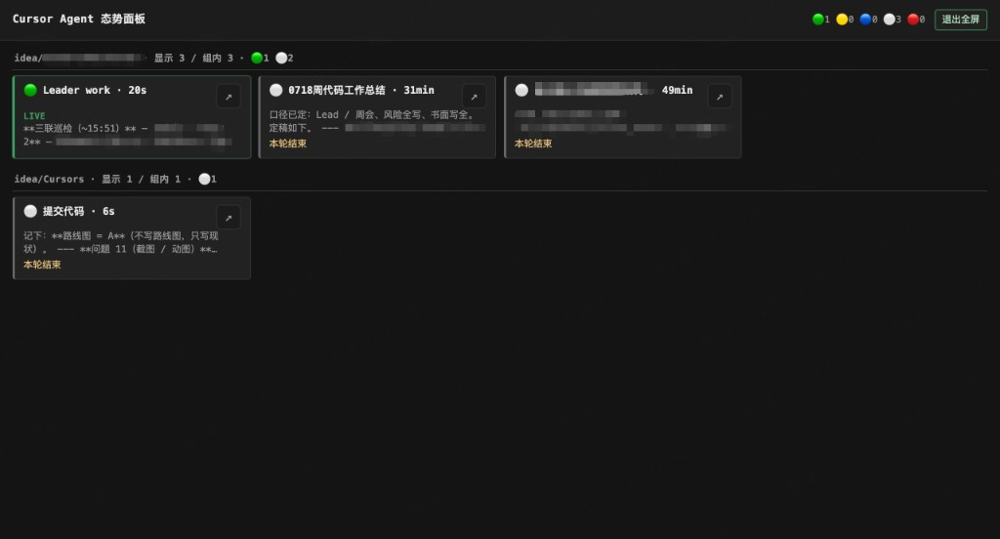

# cursor-watch

[中文](./README.md)

## What it is

`cursor-watch` is a **local, read-only situational panel** for Cursor Agent: see in a browser which sessions are running and which are waiting on you.

When you run agents across multiple projects, it groups sessions by workspace and surfaces unread / “turn ended” signals. Optional hooks add a LIVE marquee and more accurate “running” status. From the panel you can **open the matching workspace folder** in Cursor on this Mac — it does **not** deep-link into a specific Agent/chat, and it does **not** modify, inject, or orchestrate sessions.

It is not a task hub, not remote monitoring, and not a replacement for Cursor’s sidebar. It only reads local Cursor data (see below). **macOS only** (opening the browser and the workspace relies on macOS `open` / `open -a Cursor`; other platforms are unsupported). The server binds to localhost and shows paths and message excerpts in the clear (no redaction) — do not expose the port to the network.

## Screenshot



## Requirements

- **macOS** only (do not install on other platforms)
- **Node.js ≥ 20**
- **Cursor** installed on this Mac
- Scannable data appears under `~/.cursor/projects` after you have run Agent sessions locally (the panel may be empty with no Agent history)
- Fully local: no network or extra accounts required

## Install

This tool ships in a private repo — it is **not** published to the npm registry. Do **not** run `npm i -g cursor-watch` (you may hit an unrelated package or fail).

```bash
git clone git@github.com:zhangchengk/Cursors.git
cd Cursors/cursor-watch
npm install
```

Then run from **inside the `cursor-watch` directory** so `npx` resolves this repo’s `bin`, not a public package:

```bash
npx cursor-watch open
```

To expose the CLI globally from any directory, once in the same folder:

```bash
npm link
# then from anywhere:
cursor-watch open
```

Both `npm link` and `npx` point at this repo, not the registry. For development: `npm test`; for a watch/reload loop: `npm run dev`.

## Usage

```bash
npx cursor-watch open    # start daemon if needed, open the panel
npx cursor-watch status  # daemon / port status as JSON
npx cursor-watch stop    # stop the daemon
```

- Default panel: `http://127.0.0.1:7423`
- Override port: `CURSOR_WATCH_PORT`

On the panel, **↗ / “Open in Cursor”** opens the session’s **workspace folder** in Cursor on this Mac — not a specific Agent/chat. The top bar supports fullscreen (`F`).

### Hooks (optional)

```bash
npx cursor-watch hooks install
npx cursor-watch hooks status
npx cursor-watch hooks uninstall
```

The panel works without hooks: “running / waiting” then come mainly from transcripts and terminals, and may lag or miss updates.

With hooks you get an extra LIVE snapshot stream (tool use / response / stop), a mini marquee (tool and action hints), and more sensitive “running” detection — still **not** millisecond telemetry; do not treat it as ground truth. Hook script failures do not break Cursor.

## Reading the panel

- Sessions are grouped by **workspace** (project path). Group headers show the path, “showing k / m in group”, and a per-group status summary.
- Each group shows up to **Top 4** cards by default, and always keeps sessions with unread or “turn ended” reminders.
- The top-bar colored dots are global session counts (same colors as card dots): running, waiting, subagent, idle/read, error.
- Card titles prefer the Agent sidebar chat name; otherwise they fall back to the first user-message summary.
- **LIVE** sessions show a mini marquee (or a LIVE badge); hooks make this more timely.
- **Unread**: from Cursor `composerHeaders` `hasUnread` (same idea as the sidebar unread flag); the card shows a “please check” reminder.
- **Turn ended**: set when hooks receive `stop` and write `turnEnded` on the live snapshot; without hooks you usually will not see this reminder.
- Click a card to open the drawer (per-session detail: status wording and recent message excerpts).
- **↗** **opens the workspace folder only — it does not jump to a specific chat**.

## Architecture overview

```text
CLI (open/status/stop)
        │
        ▼
   daemon (long-running)
        │
        ├─ watcher + scan-worker  ──read──►  ~/.cursor/projects
        │         │                    (transcripts / terminals)
        │         │              ──opt──►   ~/.cursor-watch/live (hooks)
        │         │              ──read──►  composerHeaders (chat name / unread)
        │         ▼
        │      SessionStore
        │         │
        └─ Fastify: static UI + /api/* + /ws
                  │
                  ▼
            Browser panel (near-real-time over WebSocket)
```

Flow:

1. `cursor-watch open` starts the daemon if the port is free, then opens the browser.
2. The watcher (chokidar) triggers scan-worker to scan and infer session state into an in-memory store.
3. The UI loads `GET /api/sessions` and receives updates on `/ws`.
4. Before display, child sessions are folded in, missing workspace directories are dropped, and sessions are kept if they have unread or activity within about one hour.
5. Running / waiting / LIVE come from transcripts, terminals, and optional live snapshots (details in the appendix).

## Trust boundary

- HTTP/WebSocket bind to **`127.0.0.1` only** (default port `7423`).
- The panel shows workspace paths and message snippets **in the clear** — no redaction.
- Do **not** expose the port to the internet or reverse-proxy it to other people.
- **Read-only scope**: scanning `~/.cursor/projects` (transcripts / terminals) and `composerHeaders` never writes session content back.
- **Write exception**: only `hooks install` writes `~/.cursor/hooks.json`, `~/.cursor/hooks/`, and runtime `~/.cursor-watch/live`; remove them with `hooks uninstall`.
- “Open in Cursor” only accepts workspace paths that already appear in the **current scanned session list**; other paths are rejected.
- There is **no auth**: anyone who can reach the port can see paths and message excerpts in the clear. The trust boundary is whoever can log into this Mac.

## Appendix: implementation notes

### Modules

| Module | Role |
|---|---|
| `cli.ts` | `open` / `status` / `stop` / `daemon` / `hooks` |
| `daemon.ts` | pid file, HTTP listen, start watcher |
| `watcher.ts` + `scan-worker.ts` | file watch; scan in a child process so listen stays responsive |
| `scanner.ts` | walk projects, parse transcripts/terminals, merge live + composer meta |
| `aggregator.ts` | fold child sessions; filter what the panel should show |
| `infer/status.ts` | derive `AgentStatus` from transcript + shell |
| `live-state.ts` | hooks snapshots → `live` / `turnEnded`, override status |
| `chat-names.ts` | read-only `composerHeaders` (chat name, unread, …) |
| `open-workspace.ts` | path allow-list, then macOS `open -a Cursor <path>` |
| `server.ts` | static UI, `/api/*`, `/ws` |
| `web/*` | panel UI, grouping, drawer copy |

### Data sources

| Path | Use |
|---|---|
| `~/.cursor/projects/<key>/agent-transcripts/` | session JSONL |
| terminals under the same project | whether a shell is still running / exit code |
| Cursor local DB `composerHeaders` | chat name, `hasUnread`, … |
| `~/.cursor-watch/live/<conversationId>.json` | LIVE snapshots from hooks (optional) |

Transcripts older than **7 days** by mtime are skipped (`SCAN_LOOKBACK_MS`).

### Key constants

| Constant | Default | Meaning |
|---|---|---|
| `DEFAULT_PORT` | `7423` | listen port (`CURSOR_WATCH_PORT` overrides) |
| `ACTIVE_WINDOW_MS` | 1h | without unread, drop from panel after this |
| `RUNNING_WINDOW_MS` | 2min | “recently active” window for running inference |
| `GROUP_TOP_N` | 4 | default cards per group (reminders always kept) |
| `LIVE_TTL_MS` | 60s | how long a live snapshot counts as LIVE |
| `RECENT_MESSAGE_COUNT` | 8 | recent messages in the drawer |

### Status & aggregation (essentials)

**Inference (simplified)**

1. Tool failure or non-zero shell exit → `error`
2. Recent tool/shell activity → `running`
3. Subagents running → `subagent`
4. Last role is assistant → `waiting`
5. Else → `idle`

**LIVE override (non-error):** live snapshot → force `running`; turn ended or non-running → `waiting` / `idle` from unread.

**Kept after aggregate:** workspace directory still exists, and (`hasUnread` **or** within `ACTIVE_WINDOW_MS`).

### HTTP / WebSocket

| Endpoint | Notes |
|---|---|
| `GET /api/health` | `{ ok: true }` |
| `GET /api/sessions` | current `SessionState[]` |
| `POST /api/open-workspace` | body `{ path }`; `{ ok: true }` or 4xx/5xx + `error` |
| `GET /ws` | `{ type: "sessions", payload: SessionState[] }` |

Open-workspace does **not** pass Cursor CLI `-r` (avoids the wrong reused window). On macOS it always uses `open -a Cursor <folder>`.

### Common `SessionState` fields

| Field | Meaning |
|---|---|
| `id` / `projectKey` | session id and Cursor project key |
| `workspacePath` / `workspaceLabel` | project path and label |
| `status` | `waiting` \| `running` \| `subagent` \| `idle` \| `error` |
| `summary` / `chatName` | fallback summary / sidebar name |
| `currentAction` / `liveHint` | current action and LIVE hint |
| `hasUnread` / `live` / `turnEnded` | unread, LIVE, turn ended |
| `recentMessages` | drawer messages |
| `lastActivityAt` (and related) | sorting and time windows |

### Hooks

`hooks install` registers user-level entries in `~/.cursor/hooks.json` (marked for clean uninstall):

- `preToolUse`
- `afterAgentResponse`
- `stop`

The observe script writes `~/.cursor-watch/live/`. Failures/timeouts follow Cursor hook rules and must not take down the Agent.

### Tests

```bash
npm test          # vitest
npm run build     # tsc
```
