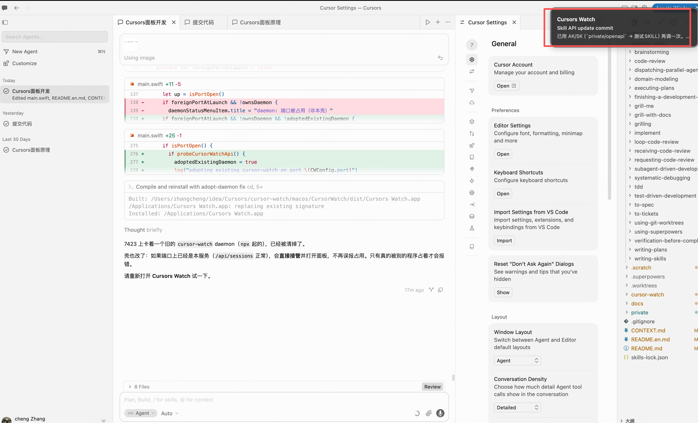
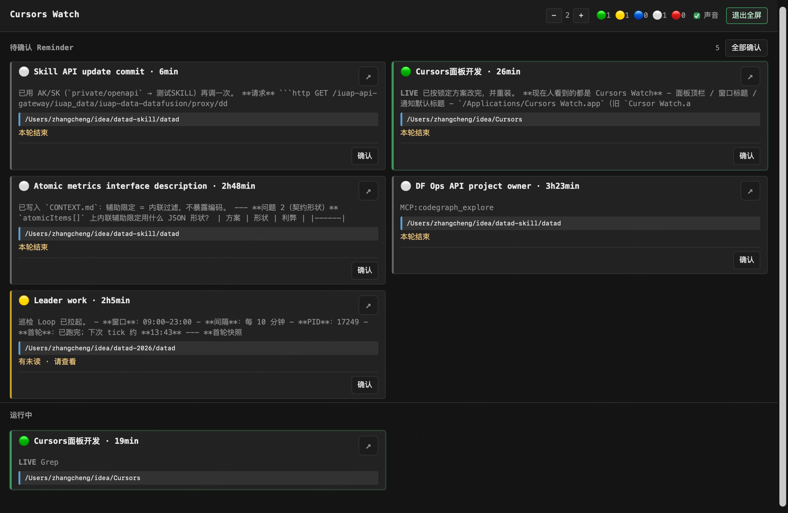

# Cursors Watch

[English](./README.en.md)

Cursors Watch 盯的是本机多个 Cursor Agent 会话（npm 包名仍是 `cursor-watch`）。某次对话 Turn end 时，它用系统通知或 HUD 打断你，并在面板收件箱留下一条待确认；下方「运行中」列出当前还在跑的会话。面板顶栏还有 **Todo / Archive** 馆藏：把想法已验证、待落地的 Chat 标成代办，或把值得回看、本机当面宣讲的 Chat 归档，可加标题/备注与文件夹（本机全局树）。

发 Reminder 需要 hooks；打开对应 Agent Chat 需要桥扩展（均随 App/`open` **默认安装并自检**）。会话仍处在 Active `/loop` 时，hooks 打出的 `stop` 不算结束，避免误报。面板 `↗` 会先打开该会话工作区，再经桥扩展调用 Cursor 命令聚焦对应 Chat（已在 Cursor 3.13.x 验证；属半内部 API，大版本升级后若失效会降级为仅开工程并 toast）。不会改会话内容或替你调度。

它不是任务中枢或远程监控，也不能替代 Cursor 侧边栏；馆藏不做导出或多人同步。数据只读本机 Cursor 目录（见后文），馆藏标注写在 `~/.cursor-watch/`，且仅支持 macOS。服务只绑 localhost，路径和消息摘录按原文展示、不做脱敏，所以不要把端口暴露到公网。

## 截图

在 Cursor 里写代码时，Cursors Watch 用系统通知 / HUD 打断你（不必切到浏览器）：



全屏面板：上方「待确认 Reminder」收件箱，下方「运行中」会话；顶栏可调列数、看状态计数、开关声音与全屏：



## 要求

- **macOS**（仅此平台；非 macOS 请勿安装）
- **Node.js ≥ 20**（打包 / 开发需要；用 `.dmg` 安装的 App 已内嵌运行时）
- 本机已安装 **Cursor**
- 本机有过 Agent 会话时，才会在 `~/.cursor/projects` 下产生可扫描数据（没有 Agent 会话时面板可能为空）
- 纯本地运行：不需要网络或额外账号

## 安装（推荐：菜单栏 App）

日常用法是安装非正式 App **Cursors Watch**（菜单栏 `CW`），不必每次 `npx` 再开浏览器。

```bash
git clone git@github.com:zhangchengk/cursors-watch.git
cd cursors-watch/cursor-watch
npm install
npm run package:dmg           # 生成 .dmg
# 或本机直接覆盖安装：
npm run package:app:install   # → /Applications/Cursors Watch.app
```

- **`.dmg` 产物**：`macos/CursorWatch/dist/Cursors-Watch-<version>.dmg`  
  打开后把 **Cursors Watch** 拖进 Applications。未公证；首次打开若被拦，在「系统设置 → 隐私与安全性」允许即可。
- 安装后从「应用程序」打开：**登录时打开**默认开启（菜单可关）；壳负责拉起 daemon、打开面板。
- **Reminder**：优先壳的系统通知；权限未开或失败则壳内 **HUD** 浮层兜底。
- 若 `7423` 上已是本服务的旧 daemon，壳会**接管**并打开面板；只有被其它程序占用才会报错。
- 更新：再跑 `package:dmg` / `package:app:install` 覆盖。不含 hooks 一键安装与自动更新。
- **完全磁盘访问**：壳在首次启动时若尚未授权，会**询问一次**并引导到「系统设置 → 隐私与安全性 → 完全磁盘访问权限」勾选 Cursors Watch（菜单栏右键也可再打开）。授权后一般不必再对桌面/文稿等逐个点允许。安装脚本用本机固定签名证书（`~/.cursor-watch/codesign.keychain`），避免覆盖安装后因 ad-hoc 签名变化而丢权限、再弹一遍。

技术标识保持 `cursor-watch` / `com.cursor-watch.*`；人看见的名字是 **Cursors Watch**。

### 开发 / CLI（可选）

本包为私有仓库工具，**不能**从 npm registry 安装；也**不要**执行 `npm i -g cursor-watch`。

```bash
cd cursors-watch/cursor-watch
npx cursor-watch open     # 按需拉起 daemon，并用浏览器打开面板
npx cursor-watch status
npx cursor-watch stop
npm link                  # 可选：任意目录可用 cursor-watch
```

- 默认面板：`http://127.0.0.1:7423`（环境变量 `CURSOR_WATCH_PORT` 可改）
- 开发自检：`npm test`；热重载：`npm run dev`
- 调试壳（不装到 Applications）：

```bash
CURSOR_WATCH_ROOT="$PWD" open "macos/CursorWatch/dist/Cursors Watch.app"
```

### Hooks（可选，发 Reminder 需要）

```bash
npx cursor-watch hooks install
npx cursor-watch hooks status
npx cursor-watch hooks uninstall
```

不安装也可看面板：「在跑」主要靠 transcript 与 terminals 推断，可能略滞后。装上 hooks 后多一路 LIVE 快照，才能触发 Reminder（通知 + 收件箱），「在跑」也更准，但仍不是毫秒级遥测。Active `/loop` 哨兵还在时，tick 间隙的 `stop` 会被压制。hooks 失败不影响 Cursor 本身。

## 面板怎么读

- 顶栏是 Cursors Watch；可调卡片列数（默认 2，窄屏 <720px 强制 1 列）、状态色点计数、声音（默认静音）、全屏（`F`；App 内走系统全屏）。
- 上方「待确认 Reminder」：Turn end 后需要你看的项。未装 hooks 时这里提示安装命令。可单条确认或全部确认；点通知也可确认。↗ 只打开工作区文件夹，不定位到某个 chat。
- 下方「运行中」：只列 LIVE / `running` / `subagent` 的会话卡片。
- 服务端保留策略仍作用于会话快照：未读一直保留；进行中始终可见；已读且本轮结束约 30 分钟；纯 idle 约 15 分钟。
- 顶栏色点统计全部会话（含未在「运行中」列出的 waiting / idle / error）。
- 卡片标题优先用侧边栏 chat 名，否则用首条用户消息摘要。

## 架构鸟瞰

```text
Cursors Watch.app（菜单栏壳）
        │  内嵌 Node + cursor-watch
        ▼
   daemon（常驻，默认 :7423）
        │
        ├─ watcher + scan-worker  ──只读──►  ~/.cursor/projects
        │         │                    （transcripts / terminals）
        │         │              ──可选──►  ~/.cursor-watch/live（hooks）
        │         │              ──只读──►  composerHeaders（chat 名 / 未读）
        │         ▼
        │      SessionStore
        │         │
        └─ Fastify：静态面板 + /api/* + /ws
                  │
                  ▼
         WKWebView 面板（或浏览器）
                  │
         Reminder：壳系统通知 → HUD 兜底
```

流程要点：

1. 打开 App（或 `cursor-watch open`）拉起 / 接管 daemon，再打开面板。
2. watcher 发现变更后由 scan-worker 扫描并推断状态，写入内存 store。
3. 面板 `GET /api/sessions` + `/ws` 近实时刷新；Reminder 另走 `/api/reminders` 与通知通道。
4. 展示前聚合子会话、丢掉已不存在的工作区，并按分层保留策略裁剪。

## 信任边界

- HTTP/WebSocket **仅监听** `127.0.0.1`（默认端口 `7423`）。
- 面板展示工作区路径与消息摘要的**原文**，不做脱敏。
- **不要**把端口暴露到公网，也不要通过反向代理给其他人访问。
- **只读范围**：扫描 `~/.cursor/projects` 与 `composerHeaders` 时不写回会话内容。
- **写盘例外**：仅 `hooks install` 写入 `~/.cursor/hooks.json`、`~/.cursor/hooks/` 与运行时的 `~/.cursor-watch/live`。
- 「在 Cursor 中打开」只接受**当前已扫描会话**里出现过的工作区路径。
- 服务本身**无登录鉴权**：信任边界等于「能登录这台 Mac 的用户」。

## 附录：实现说明

### 模块职责

| 模块 | 作用 |
|---|---|
| `cli.ts` | `open` / `status` / `stop` / `daemon` / `hooks` |
| `daemon.ts` | 写 pid、起 HTTP、挂 watcher |
| `watcher.ts` + `scan-worker.ts` | 文件监听；子进程扫描 |
| `scanner.ts` | 遍历 projects、解析 transcript / terminals、合并 live |
| `aggregator.ts` | 子会话并入父会话；过滤不可见会话 |
| `infer/status.ts` | 由 transcript + shell 推断 `AgentStatus` |
| `live-state.ts` / `reminders/*` | LIVE、Turn end Reminder、通知适配器 |
| `loop-ledger/*` | Active `/loop` 哨兵账本（压制误报） |
| `open-workspace.ts` | 校验路径后 `open -a Cursor <path>` |
| `open-chat.ts` / `bridge/hub.ts` | 开工程 + 经扩展桥 `canvas.openAgentByConversationId` 聚焦 Chat |
| `server.ts` | 静态资源、`/api/*`、`/ws` |
| `web/*` | 收件箱优先面板（待确认 + 运行中） |
| `macos/CursorWatch` + `scripts/package-*.sh` | 菜单栏壳、`.app` / `.dmg` 打包 |

### 数据源

| 路径 | 用途 |
|---|---|
| `~/.cursor/projects/<key>/agent-transcripts/` | 会话 JSONL |
| 同项目下 terminals | Shell 是否仍在跑 / 退出码 |
| Cursor 本地 DB `composerHeaders` | chat 名称、`hasUnread` 等 |
| `~/.cursor-watch/live/<conversationId>.json` | hooks LIVE 快照（可选） |
| `~/.cursor-watch/shell-notify/` | 壳通知桥（`shell.alive` + intent JSON） |

扫描时跳过 mtime 早于 **7 天**（`SCAN_LOOKBACK_MS`）的 transcript。

### 关键常量

| 常量 | 默认 | 含义 |
|---|---|---|
| `DEFAULT_PORT` | `7423` | 监听端口（可用 `CURSOR_WATCH_PORT` 覆盖） |
| `TURN_ENDED_KEEP_MS` | 30min | 已读且 turnEnded 的最长保留 |
| `IDLE_KEEP_MS` | 15min | 纯 idle 的最长保留 |
| `RUNNING_WINDOW_MS` | 2min | 「最近活跃」窗口 |
| `LIVE_TTL_MS` | 60s | live 快照视为 LIVE 的时长 |
| `RECENT_MESSAGE_COUNT` | 8 | 抽屉最近消息条数 |

### 状态与聚合（要点）

1. 工具失败或 shell 非 0 → `error`
2. 近期工具/shell 活动 → `running`
3. 有子 Agent 在跑 → `subagent`
4. 最后一条是 assistant → `waiting`
5. 否则 → `idle`

**LIVE 盖写（非 error）**：live → 强制 `running`；turn ended 或非运行态 → 按未读变为 `waiting` / `idle`。

### HTTP / WebSocket

| 接口 | 说明 |
|---|---|
| `GET /api/health` | `{ ok: true }` |
| `GET /api/sessions` | 当前 `SessionState[]` |
| `GET /api/reminders` | 待确认 Reminder 列表 |
| `POST /api/reminders/:conversationId/ack` | 确认一条 Reminder |
| `GET /api/hooks-status` | hooks 是否已安装 |
| `POST /api/open-workspace` | body `{ path }` |
| `POST /api/open-chat` | body `{ conversationId, workspacePath }` → 开工程并聚焦 Chat |
| `GET /api/bridge-status` | `{ online, extensionVersion? }` |
| `GET /ws` | 推送 `sessions` / `reminders` |

### Hooks

`hooks install` 向用户级 `~/.cursor/hooks.json` 注册（可卸载）：

- `preToolUse`
- `afterAgentResponse`
- `stop`

观察脚本写入 `~/.cursor-watch/live/`；失败不拖垮 Agent。

### 测试与打包

```bash
npm test                 # vitest
npm run build            # tsc
npm run package:app      # 仅构建 .app
npm run package:app:install
npm run package:dmg      # 分发用 .dmg
```
